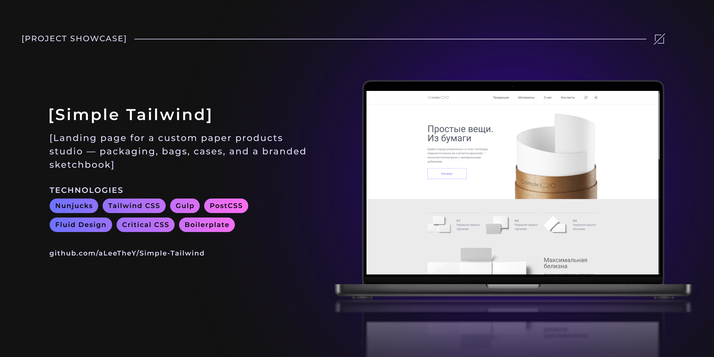
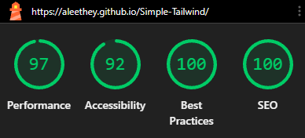
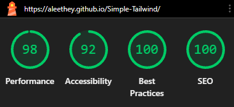

<!-- Improved compatibility of back to top link: See: https://github.com/othneildrew/Best-README-Template/pull/73 -->

<span id="readme-top"></span>

<!-- ! --- REPO SHIELDS --->
<!-- ! ---------------- --->

<div align="center">

[![Contributors][contributors-shield]][contributors-url] [![Forks][forks-shield]][forks-url] [![Stargazers][stars-shield]][stars-url] [![Issues][issues-shield]][issues-url] [![License][license-shield]][license-url]

![GitHub Last Commit][last-commit-shield] ![GitHub Repo Size][repo-size-shield]

[](README.md) [](README.ru.md)

</div>

<!-- ! --- REPO HEADER --->
<!-- ! --------------- --->

<br />
<div align="center">
  <h1 align="center">Simple Tailwind</h1>

  <p align="center">
    📄 Landing page for a custom paper products studio — packaging, bags, cases, and a branded sketchbook.
    <br />
    <br />
    
    <hr />
    <b><a href="https://aleethey.github.io/Simple-Tailwind/">Live Demo</a></b>
    &middot;
    <b><a href="https://github.com/aLeeTheY/Simple-Tailwind/issues/new?labels=bug&template=bug-report.md">Report Bug</a></b>
    <hr />
  </p>
</div>

<!-- ! --- TABLE OF CONTENTS --->
<!-- ! --------------------- --->

<details>
  <summary>📦 Table of Contents</summary>
  <ol>
    <li>
      <a href="#about-the-project">ℹ️ About the Project</a>
      <ul>
        <li><a href="#design">🎨 Design</a></li>
        <li>
          <a href="#showcase">🎬 Showcase</a>
          <ul>
            <li><a href="#website-walkthrough">🖥️📱 Website Walkthrough</a></li>
            <li><a href="#fluid-design-demo">💧 Fluid Design Demo</a></li>
          </ul>
        </li>
        <li><a href="#key-features">✨ Key Features</a></li>
        <li><a href="#built-with">🧰 Built With</a></li>
        <li><a href="#project-structure">📂 Project Structure</a></li>
        <li><a href="#supported-browsers">🌐 Supported Browsers</a></li>
      </ul>
    </li>
    <li>
      <a href="#quick-start">🚀 Quick Start</a>
      <ul>
        <li><a href="#prerequisites">📋 Prerequisites</a></li>
        <li><a href="#installation">📥 Installation</a></li>
        <li><a href="#build-launch">⚙️ Build & Launch</a></li>
      </ul>
    </li>
    <li><a href="#usage">💡 Usage</a></li>
    <li><a href="#development-challenges">🧠 Development Challenges</a></li>
    <li><a href="#key-skills">📈 Key Skills</a></li>
    <li><a href="#roadmap">🗺️ Roadmap</a></li>
    <li><a href="#license">📄 License</a></li>
    <li><a href="#contact">🤝 Contact</a></li>
    <li><a href="#acknowledgments">💖 Acknowledgments</a></li>
  </ol>
</details>

<!-- ! --- ABOUT THE PROJECT --->
<!-- ! --------------------- --->

## ℹ️ About the Project <span id="about-the-project"></span>

The goal of this project is to develop a single-page responsive landing page for a studio, with a focus on mastering [Tailwind CSS](https://tailwindcss.com/) and [Beasties](https://github.com/danielroe/beasties).

> [!NOTE]
> The frontend is built on a custom Gulp setup. Its documentation is available in the repository:
>
> [**Wishbone-plus-Partners**](https://github.com/aLeeTheY/Wishbone-plus-Partners)

<p align="right">(<a href="#readme-top">back to top</a>)</p>

<!-- ! --- DESIGN --->
<!-- ! ---------- --->

### 🎨 Design <a id="design"></a>

The visual part is based on the [**Simple**](https://verstaem.online/layouts/simple) layout provided by the [**verstaem.online**](https://verstaem.online/) platform.

The objective is to recreate the interface using **Tailwind CSS** and adapt it to various screen sizes.

<p align="right">(<a href="#readme-top">back to top</a>)</p>

<!-- ! --- DEMO / SHOWCASE --->
<!-- ! ------------------- --->

### 🎬 Showcase <span id="showcase"></span>

A video demonstration of the project is presented below (*click any image to open the live demo*):

<div align="center">

#### 🖥️📱 Website Walkthrough (Desktop + Mobile) <span id="website-walkthrough"></span>

[![Website Walkthrough][01-website-walkthrough]](https://aleethey.github.io/Simple-Tailwind/)

<p align="right">(<a href="#readme-top">back to top</a>)</p>

#### 💧 Fluid Design Demo (DevTools Stretch Test) <span id="fluid-design-demo"></span>

[![Fluid Design Demo][02-fluid-design-demo]](https://aleethey.github.io/Simple-Tailwind/)

<p align="right">(<a href="#readme-top">back to top</a>)</p>

</div>

<!-- ! --- KEY FEATURES --->
<!-- ! ---------------- --->

### ✨ Key Features <span id="key-features"></span>

- 🧩 **Tailwind CSS:** a modern approach to website styling using utility-first classes.
- ⚡ **High Loading Speed:** critical CSS is inlined into the `<head>`, raster images are converted to AVIF/WebP, icons are compiled into an SVG sprite, and HTML/CSS are minified during the build process.
- 💧 **Fluid Design:** fluid layout with smooth typography based on 4 breakpoints (implemented via `clamp()`): mobile → tablet → laptop → desktop.

#### ⚡ Google Lighthouse Benchmark <a id="google-lighthouse-benchmark"></a>

To confirm the quality of the layout, the test results from the **Google Lighthouse** benchmark (desktop and mobile versions) are presented below:

<div align="center">

|                          🖥️ Desktop Version                          |                         📱 Mobile Version                          |
| :------------------------------------------------------------------: | :----------------------------------------------------------------: |
|  |  |

</div>

<p align="right">(<a href="#readme-top">back to top</a>)</p>

<!-- ! --- BUILT WITH --->
<!-- ! -------------- --->

### 🧰 Built With <span id="built-with"></span>

_For convenience, all information is divided into categories._

<details>
<summary>🎨 Frontend</summary>

- [![Nunjucks][Nunjucks-logo]][Nunjucks-url] <sup>— component-based templating engine for modular HTML page assembly</sup>
- [![Tailwind CSS][TailwindCSS-logo]][TailwindCSS-url] <sup>— utility-first CSS framework for interface styling</sup>

</details>

<details>
<summary>📦 Build</summary>

- [![Node.js][NodeJS-logo]][NodeJS-url] <sup>— runtime environment for JavaScript packages</sup>
  - [![Npm][Npm-logo]][Npm-url] <sup>— JavaScript package manager and dependency management</sup>
- [![Gulp 5][Gulp-logo]][Gulp-url] <sup>— task runner and build pipeline orchestrator</sup>
  - **Packages integrated into Gulp:**
    - [![SVGO][SVGO-logo]][SVGO-url] <sup>— vector image processing and SVG sprite generation</sup>
    - [![Sharp][sharp-logo]][sharp-url] <sup>— raster image processing and AVIF/WebP format generation during the build</sup>
    - [![PostCSS][PostCSS-logo]][PostCSS-url] <sup>— CSS post-processing and optimization</sup>
    - [![PostHTML][PostHTML-logo]][PostHTML-url] <sup>— HTML post-processing and optimization</sup>
  - **External CLI tools (automatically invoked via Gulp):**
    - [![FFmpeg][ffmpeg-logo]][ffmpeg-url] <sup>— audio and video asset processing, WebM format generation during the build</sup>
    - [![Foundry Tools CLI][FoundryToolsCLI-logo]][FoundryToolsCLI-url] <sup>— conversion of source OTF/TTF fonts to WOFF and WOFF2 formats</sup>

</details>

<details>
<summary>🧪 Testing</summary>

- [![PlayWright][PlayWright-logo]][PlayWright-url] <sup>— manual layout testing across browser engines: Chromium (Google Chrome), Gecko (Mozilla Firefox), and WebKit (Safari)</sup>

</details>

<details>
<summary>📝 Code Style & Formatting</summary>

- [![Husky][Husky-logo]][Husky-url] <sup>— client-side automatic Git hooks management</sup>
  - [![lint-staged][LintStaged-logo]][LintStaged-url] <sup>— running linters and formatters on files before committing (`pre-commit`)</sup>
  - [![Commitlint][CommitLint-logo]][CommitLint-url] <sup>— validation of Git messages according to the Conventional Commits specification (with custom `wip` and `deploy` types)</sup>
- [![Browserslist][Browserslist-logo]][Browserslist-url] <sup>— declaring the list of target browsers and their minimum versions</sup>
- [![EditorConfig][EditorConfig-logo]][EditorConfig-url] <sup>— code style applied to the IDE by default</sup>
- [![ESLint][ESLint-logo]][ESLint-url] <sup>— linter for TypeScript and JavaScript sources (including configuration files)</sup>
- [![Stylelint][Stylelint-logo]][Stylelint-url] <sup>— linter for SCSS and CSS sources</sup>
- [![Prettier][Prettier-logo]][Prettier-url] <sup>— automatic code formatting</sup>

</details>

<details>
<summary>🌿 Version Control & Repository Hosting</summary>

- [![Git][Git-logo]][Git-url] <sup>— distributed version control system</sup>
- [![GitHub][GitHub-logo]][GitHub-url] <sup>— platform for hosting source code and publishing releases</sup>
- [![GitHub Pages][GithubPages-logo]][GithubPages-url] <sup>— static hosting for the live demo version of the website</sup>

</details>

<details>
<summary>🖥️ Development Tools</summary>

- [![Figma][Figma-logo]][Figma-url] <sup>— UI/UX layout design tool</sup>
- [![Visual Studio Code][VSCode-logo]][VSCode-url] <sup>— code editor</sup>

</details>

<p align="right">(<a href="#readme-top">back to top</a>)</p>

<!-- ! --- PROJECT STRUCTURE --->
<!-- ! --------------------- --->

### 📂 Project Structure <span id="project-structure"></span>

Main directories and project files:

```text
Simple-Tailwind/
│
├── .husky/                                         # Git hooks
├── .vscode/
│
├── docs/                                           # Project documentation
│   ├── assets/
│   └── utils/
│
├── gulp/                                           # Source code of the custom Gulp build
│   ├── config/                                     # Configuration files
│   │   ├── build.js
│   │   ├── env.js
│   │   ├── ftp.js
│   │   └── path.js
│   │
│   ├── helpers/                                    # Custom utilities used across various tasks
│   │   ├── asset-exists.js
│   │   ├── django-domain.js
│   │   ├── error-handler.js
│   │   ├── html-img2picture-transformer.js
│   │   ├── inline-assets.js
│   │   └── path-resolver.js
│   │
│   └── tasks/                                      # Gulp task modules
│       ├── assets/                                 # Static assets processing
│       │   ├── fonts/
│       │   │   └── fonts.js
│       │   │
│       │   ├── media/
│       │   │   ├── audio.js
│       │   │   └── videos.js
│       │   │
│       │   ├── pictures/
│       │   │   ├── icons.js
│       │   │   └── images.js
│       │   │
│       │   └── misc.js
│       │
│       ├── core/                                   # Dev modules: pipeline, dev server, and watchers
│       │   ├── dev/
│       │   │   ├── server.js
│       │   │   └── watch.js
│       │   │
│       │   ├── clean.js
│       │   └── main-tasks.js
│       │
│       ├── html/                                   # HTML/Nunjucks processing
│       │   ├── nunjucks/
│       │   │   └── clean-file-system-nunjucks-loader.js
│       │   │
│       │   ├── djangoize-html.js
│       │   └── html.js
│       │
│       ├── meta/                                   # Meta files processing
│       │   └── meta.js
│       │
│       ├── scripts/                                # JS/TS processing
│       │   ├── libs.js
│       │   └── scripts.js
│       │
│       ├── styles/                                 # CSS/SCSS processing
│       │   ├── critical-css.js
│       │   ├── obfuscate-selectors.js
│       │   └── styles.js
│       │
│       └── utils/                                  # Miscellaneous utilities
│           ├── ftp.js
│           ├── revision.js
│           └── zip.js
│
├── src/
│   ├── assets/                                     # Static resources
│   │   ├── audio/
│   │   │   └── .gitkeep
│   │   │
│   │   ├── fonts/
│   │   │   └── Roboto/
│   │   │       ├── OFL.txt
│   │   │       └── Roboto-VariableFont_wdth,wght.ttf
│   │   │
│   │   ├── icons/
│   │   │   ├── companies/
│   │   │   │   ├── canson.svg
│   │   │   │   ├── fabriano.svg
│   │   │   │   ├── hahnemuehle.svg
│   │   │   │   └── royal_talens.svg
│   │   │   │
│   │   │   ├── copyright/
│   │   │   │   └── copyright.svg
│   │   │   │
│   │   │   ├── form/
│   │   │   │   ├── search-form__close-btn.svg
│   │   │   │   └── search-form__search-btn.svg
│   │   │   │
│   │   │   ├── logo/
│   │   │   │   └── logo.svg
│   │   │   │
│   │   │   ├── menu/
│   │   │   │   ├── close.svg
│   │   │   │   ├── hamburger_menu.svg
│   │   │   │   └── login.svg
│   │   │   │
│   │   │   ├── other/
│   │   │   │   └── arrow.svg
│   │   │   │
│   │   │   └── social/
│   │   │       ├── facebook.svg
│   │   │       ├── instagram.svg
│   │   │       ├── twitter.svg
│   │   │       └── youtube.svg
│   │   │
│   │   ├── images/
│   │   │   ├── assortment/
│   │   │   │   ├── sec3_img1.png
│   │   │   │   ├── sec3_img2.png
│   │   │   │   ├── sec3_img3.png
│   │   │   │   └── sec3_img4.png
│   │   │   │
│   │   │   ├── papers/
│   │   │   │   ├── paper_big.png
│   │   │   │   ├── paper_v1.png
│   │   │   │   ├── paper_v2.png
│   │   │   │   └── paper_v3.png
│   │   │   │
│   │   │   ├── hero.png
│   │   │   └── sketchbook.png
│   │   │
│   │   ├── misc/
│   │   │   └── .gitkeep
│   │   │
│   │   └── videos/
│   │       └── .gitkeep
│   │
│   ├── css/                                        # Tailwind CSS source files
│   │   ├── layers/
│   │   │   ├── base.css
│   │   │   ├── components.css
│   │   │   ├── theme.css
│   │   │   └── utilities.css
│   │   │
│   │   └── main.css
│   │
│   ├── html/                                       # Nunjucks templates
│   │   ├── base/
│   │   │   └── base.njk
│   │   │
│   │   ├── common/
│   │   │   ├── footer.njk
│   │   │   └── header.njk
│   │   │
│   │   ├── components/
│   │   │   └── cookie_consent.njk
│   │   │
│   │   ├── macros/
│   │   │   ├── macro__current_page__get_full_url.njk
│   │   │   ├── macro__hreflang_meta_tags.njk
│   │   │   ├── macro__i18n_button__2_langs.njk
│   │   │   └── macro__inline_script.njk
│   │   │
│   │   ├── service/
│   │   │   ├── head.njk
│   │   │   ├── scripts__postload.njk
│   │   │   └── scripts__preload.njk
│   │   │
│   │   └── index.njk
│   │
│   ├── i18n/                                       # Localization (not used in the project)
│   │   ├── languages.json
│   │   └── ru_RU.json
│   │
│   ├── libs/                                       # Third-party JS libraries
│   │   └── .gitkeep
│   │
│   ├── meta/                                       # SEO and meta files
│   │   ├── favicon/
│   │   │   ├── apple-touch-icon.png
│   │   │   ├── favicon-96x96.png
│   │   │   ├── favicon.ico
│   │   │   ├── favicon.svg
│   │   │   ├── site.webmanifest
│   │   │   ├── web-app-manifest-192x192.png
│   │   │   └── web-app-manifest-512x512.png
│   │   │
│   │   ├── humans.txt
│   │   ├── robots.txt
│   │   └── sitemap.xml
│   │
│   ├── ts/                                         # TypeScript source files (not used in the project)
│   │   ├── modules/
│   │   │   └── postload/
│   │   │       └── .gitkeep
│   │   │
│   │   └── postload.ts
│   │
│   └── site.config.json                            # Base domains and URL path prefixes for different build scenarios
│
├── tests/                                          # Manual layout testing via PlayWright
│   └── playwright/
│       ├── example.spec.ts
│       └── start_manual_website_test_in_playwright_browsers.ts
│
├── .browserslistrc                                 # List of supported browsers
├── .editorconfig
├── .editorconfig-checker.json
├── .gitattributes
├── .gitignore
├── .lintstagedrc.yml
├── .npmrc
├── .prettierignore
├── .stylelintignore
├── commitlint.config.ts
├── eslint.config.ts                                # ESLint configuration
├── gulpfile.js                                     # Main Gulp build file
├── LICENSE
├── package-lock.json
├── package.json
├── playwright.config.ts
├── postcss.config.js                               # PostCSS configuration
├── posthtml.config.js                              # PostHTML configuration
├── prettier.config.mts
├── README.md
├── README.ru.md
├── stylelint.config.ts                             # Stylelint configuration
├── svgo.config.mjs                                 # SVGO configuration
└── tsconfig.json
```

<p align="right">(<a href="#readme-top">back to top</a>)</p>

<!-- ! --- SUPPORTED BROWSERS --->
<!-- ! ---------------------- --->

### 🌐 Supported Browsers <a id="supported-browsers"></a>

The website has been tested for correct rendering in the following browsers:

- [![Google Chrome][GoogleChrome-logo]][GoogleChrome-url]
- [![Microsoft Edge][MicrosoftEdge-logo]][MicrosoftEdge-url]
- [![Yandex][Yandex-logo]][Yandex-url]
- [![Firefox][Firefox-logo]][Firefox-url]
- [![Opera][Opera-logo]][Opera-url]

> [!IMPORTANT]
> Verified in the latest stable versions of the browsers listed above at the time of release **[1.0.0](https://github.com/aLeeTheY/Simple-Tailwind/releases/tag/1.0.0)**.
>
> **Last verified: November 8, 2026**

<p align="right">(<a href="#readme-top">back to top</a>)</p>

<!-- ! --- QUICK START --->
<!-- ! --------------- --->

## 🚀 Quick Start <span id="quick-start"></span>

_Follow the instructions below to build and run the project on a local server._

### 📋 Prerequisites <a id="prerequisites"></a>

1. Install [Node.js][NodeJS-url], [FFmpeg][FFmpeg-url], [Python][Python-url], and [FoundryTools-CLI][FoundryToolsCLI-url].

2. Download this repository as a ZIP archive or clone it using [Git][Git-url] and navigate to the project directory:

```powershell
git clone https://github.com/aLeeTheY/Simple-Tailwind
cd Simple-Tailwind/
```

### 📥 Installation <a id="installation"></a>

While in the project directory, install all the necessary dependencies:

```sh
npm install
```

### ⚙️ Build & Launch <a id="build-launch"></a>

You can build the project by running one of the following commands:

```sh
# build in development environment with a local server launch
npm run dev

# build in production environment with a local server launch
npm run prod

# build in production environment for your domain (without a local server launch)
npm run build

# build in production environment for GitHub Pages (without a local server launch)
npm run gh-pages
```

<p align="right">(<a href="#readme-top">back to top</a>)</p>

<!-- ! --- USAGE --->
<!-- ! --------- --->

## 💡 Usage <span id="usage"></span>

After completing the "[**Quick Start**](#quick-start)" step, the website will be available at `http://localhost:3000/`, and the built files will be located in the `dist/` directory.

> [!NOTE]
> The project can be used as a boilerplate for your own landing pages.
> To understand the architecture of the Gulp pipeline, its flags, and build scenarios, it is recommended to study the project documentation:
>
> [**Wishbone-plus-Partners**](https://github.com/aLeeTheY/Wishbone-plus-Partners)

<p align="right">(<a href="#readme-top">back to top</a>)</p>

<!-- ! --- DEVELOPMENT CHALLENGES --->
<!-- ! -------------------------- --->

## 🧠 Development Challenges <span id="development-challenges"></span>

- **Beasties integration:** [penthouse](https://github.com/pocketjoso/penthouse) and [puppeteer](https://github.com/puppeteer/puppeteer) do not support Tailwind CSS syntax, specifically the `@layer` constructs. Therefore, it was decided to rewrite the entire `critical-css.js` task to use the generator from the [Beasties](https://github.com/danielroe/beasties) library.

<p align="right">(<a href="#readme-top">back to top</a>)</p>

<!-- ! --- KEY SKILLS --->
<!-- ! -------------- --->

## 📈 Key Skills <span id="key-skills"></span>

- **Tailwind CSS:** Mastered the utility-first approach to UI styling. Mastered the `@layer` directive and the base layers in Tailwind CSS.
- **Beasties Critical CSS:** Mastered the [Beasties](https://github.com/danielroe/beasties) library and configured it for critical CSS generation, replacing the outdated [penthouse](https://github.com/pocketjoso/penthouse).

<p align="right">(<a href="#readme-top">back to top</a>)</p>

<!-- ! --- ROADMAP --->
<!-- ! ----------- --->

## 🗺️ Roadmap <span id="roadmap"></span>

- [x] DOM development based on Nunjucks:
  - [x] `<header>` section
  - [x] `<footer>` section
  - [x] `<main>` section
  - [x] `<head>` section
- [x] Integration of the **Tailwind CSS** plugin into the PostCSS configuration
- [x] Website styling and responsive design implementation (**Tablet** and **Desktop**) based on **Tailwind CSS** in accordance with the design layout and **Fluid Design** principles using the **Mobile First** approach
- [x] Integration of the **Critical CSS** generator for the Gulp build based on the **Beasties** package
- [x] Project build and deployment to GitHub Pages
- [x] Preparation of technical documentation (`README.md`)

A full list of planned features and known issues is available in the [Issues][issues-url] section.

<p align="right">(<a href="#readme-top">back to top</a>)</p>

<!-- ! --- LICENSE --->
<!-- ! ----------- --->

## 📄 License <span id="license"></span>

Copyright © 2025–2026 [aLeeTheY](https://github.com/aLeeTheY)

The project is distributed under the [**MIT**](https://mit-license.org/) license.<br />See the [`LICENSE`][license-url] file for more information.

<p align="right">(<a href="#readme-top">back to top</a>)</p>

<!-- ! --- CONTACT --->
<!-- ! ----------- --->

## 🤝 Contact <span id="contact"></span>

<!-- [![GitHub][GitHub-logo]](https://github.com/aLeeTheY)
[![Telegram][Telegram-logo]](https://t.me/aLeeTheY)
[![Gmail][Gmail-logo]](mailto:aleethey@gmail.com) -->

GitHub: [aLeeTheY](https://github.com/aLeeTheY) <br/> Telegram: [@aLeeTheY](https://t.me/aLeeTheY) <br/> Email: [aleethey@gmail.com](mailto:aleethey@gmail.com)

<p align="right">(<a href="#readme-top">back to top</a>)</p>

<!-- ! --- ACKNOWLEDGMENTS --->
<!-- ! ------------------- --->

## 💖 Acknowledgments <span id="acknowledgments"></span>

[aLeeTheY](https://github.com/aLeeTheY) thanks the developers and communities behind the following projects:

- [verstaem.online](https://verstaem.online/) (for the **Simple** design layout)
- [Figma](https://www.figma.com/)
- [Visual Studio Code](https://code.visualstudio.com/)
- [Nunjucks](https://mozilla.github.io/nunjucks/)
- [Tailwind CSS](https://tailwindcss.com/)
- [Node.js](https://nodejs.org/)
- [Npm](https://www.npmjs.com/)
- [Gulp](https://gulpjs.com/)
- [Sharp](https://sharp.pixelplumbing.com/)
- [SVGO](https://github.com/svg/svgo)
- [PostHTML](https://github.com/posthtml/posthtml)
- [PostCSS](https://postcss.org/)
- [Beasties](https://github.com/danielroe/beasties)
- [EditorConfig](https://editorconfig.org/)
- [Browserslist](https://github.com/browserslist/browserslist)
- [ESLint](https://eslint.org/)
- [Stylelint](https://stylelint.io/)
- [Prettier](https://prettier.io/)
- [Husky](https://typicode.github.io/husky/)
- [lint-staged](https://github.com/lint-staged/lint-staged)
- [Commitlint](https://commitlint.js.org/)
- [Playwright](https://playwright.dev/)
- [Git](https://git-scm.com/)
- [GitHub](https://github.com/)
- [Shields.io](https://shields.io/) (for the beautiful badges)
- [Custom Icon Badges](https://github.com/DenverCoder1/custom-icon-badges)
- [Chocolatey](https://chocolatey.org/)
- [FFmpeg](https://www.ffmpeg.org/)
- [gifsicle](https://github.com/kohler/gifsicle)
- [ezgif.com](https://ezgif.com/)
- [Chrome DevTools](https://developer.chrome.com/docs/devtools)
- [Lighthouse](https://developer.chrome.com/docs/lighthouse/overview)

Without these tools, the development of this project would have been **impossible**.

<p align="right">(<a href="#readme-top">back to top</a>)</p>

<!-- ! --- MARKDOWN LINKS --->
<!-- ! ------------------ --->

<!-- * shields --->

[contributors-shield]: https://img.shields.io/github/contributors/aLeeTheY/Simple-Tailwind.svg?style=for-the-badge
[contributors-url]: https://github.com/aLeeTheY/Simple-Tailwind/graphs/contributors
[forks-shield]: https://img.shields.io/github/forks/aLeeTheY/Simple-Tailwind.svg?style=for-the-badge
[forks-url]: https://github.com/aLeeTheY/Simple-Tailwind/network/members
[stars-shield]: https://img.shields.io/github/stars/aLeeTheY/Simple-Tailwind.svg?style=for-the-badge
[stars-url]: https://github.com/aLeeTheY/Simple-Tailwind/stargazers
[issues-shield]: https://img.shields.io/github/issues/aLeeTheY/Simple-Tailwind.svg?style=for-the-badge
[issues-url]: https://github.com/aLeeTheY/Simple-Tailwind/issues
[last-commit-shield]: https://img.shields.io/github/last-commit/aLeeTheY/Simple-Tailwind?style=for-the-badge
[repo-size-shield]: https://img.shields.io/github/repo-size/aLeeTheY/Simple-Tailwind?style=for-the-badge
[license-shield]: https://img.shields.io/github/license/aLeeTheY/Simple-Tailwind.svg?style=for-the-badge
[license-url]: https://github.com/aLeeTheY/Simple-Tailwind/blob/master/LICENSE

<!-- * technologies | main --->

[Nunjucks-logo]: https://custom-icon-badges.demolab.com/badge/Nunjucks-3d8137?logo=nunjucks&style=for-the-badge
[Nunjucks-url]: https://mozilla.github.io/nunjucks/
[TailwindCSS-logo]: https://img.shields.io/badge/tailwindcss-38B2AC.svg?style=for-the-badge&logo=tailwind-css&logoColor=white
[TailwindCSS-url]: https://tailwindcss.com/

<!-- [TypeScript-logo]: https://img.shields.io/badge/TypeScript-3178C6?logo=typescript&logoColor=fff&style=for-the-badge
[TypeScript-url]: https://www.typescriptlang.org/ -->

<!-- * technologies | build --->

[NodeJS-logo]: https://img.shields.io/badge/Node.js-6DA55F?logo=node.js&logoColor=white&style=for-the-badge
[NodeJS-url]: https://nodejs.org/
[Npm-logo]: https://img.shields.io/badge/npm-CB3837?logo=npm&logoColor=fff&style=for-the-badge
[Npm-url]: https://www.npmjs.com/
[Gulp-logo]: https://img.shields.io/badge/GULP-%23CF4647.svg?style=for-the-badge&logo=gulp&logoColor=white
[Gulp-url]: https://gulpjs.com/
[PostCSS-logo]: https://img.shields.io/badge/PostCSS-%23DD3A0A.svg?style=for-the-badge&logo=postcss&logoColor=white
[PostCSS-url]: https://postcss.org/
[PostHTML-logo]: https://custom-icon-badges.demolab.com/badge/PostHTML-ffffff?logo=posthtml&style=for-the-badge
[PostHTML-url]: https://github.com/posthtml/posthtml
[SVGO-logo]: https://custom-icon-badges.demolab.com/badge/SVGO-12222b?logo=svgo&style=for-the-badge
[SVGO-url]: https://svgo.dev/
[Browserslist-logo]: https://custom-icon-badges.demolab.com/badge/browserslist-1d1d1d?logo=browserslist&style=for-the-badge
[Browserslist-url]: https://github.com/browserslist/browserslist
[Sharp-logo]: https://custom-icon-badges.demolab.com/badge/Sharp-1f2a1c?logo=sharp&style=for-the-badge
[Sharp-url]: https://sharp.pixelplumbing.com/

<!-- * technologies | url only --->

[Python-url]: https://www.python.org/

<!-- * architecture & patterns --->

<!-- [MVVM-logo]: https://custom-icon-badges.demolab.com/badge/MVVM-1f1f1f?&style=for-the-badge&logoColor=white
[MVVM-url]: https://learn.microsoft.com/en-us/dotnet/architecture/maui/mvvm
[MVVMCommandPattern-logo]: https://custom-icon-badges.demolab.com/badge/MVVM%20Command%20Pattern-1f1f1f?&style=for-the-badge&logoColor=white
[MVVMCommandPattern-url]: https://learn.microsoft.com/en-us/archive/msdn-magazine/2013/may/mvvm-commands-relaycommands-and-eventtocommand -->

<!-- * linters & code format --->

[EditorConfig-logo]: https://custom-icon-badges.demolab.com/badge/EditorConfig-010101?logo=editorconfig&style=for-the-badge
[EditorConfig-url]: https://editorconfig.org/
[ESLint-logo]: https://img.shields.io/badge/ESLint-4B3263?style=for-the-badge&logo=eslint&logoColor=white
[ESLint-url]: https://eslint.org/
[Stylelint-logo]: https://custom-icon-badges.demolab.com/badge/Stylelint-1b1b1d?logo=stylelint&style=for-the-badge
[Stylelint-url]: https://stylelint.io/
[Prettier-logo]: https://img.shields.io/badge/prettier-F7B93E.svg?style=for-the-badge&logo=prettier&logoColor=black
[Prettier-url]: https://prettier.io/
[Commitlint-logo]: https://custom-icon-badges.demolab.com/badge/Commitlint-1b1b1f?logo=commitlint&style=for-the-badge
[Commitlint-url]: https://commitlint.js.org/
[LintStaged-logo]: https://custom-icon-badges.demolab.com/badge/Lint--Staged-ffffff?logo=lintstaged&style=for-the-badge
[LintStaged-url]: https://github.com/lint-staged/lint-staged
[Husky-logo]: https://custom-icon-badges.demolab.com/badge/Husky-607d8b?logo=husky-vscode&style=for-the-badge
[Husky-url]: https://typicode.github.io/husky/

<!-- [esbuild-logo]: https://img.shields.io/badge/esbuild-%23FFCF00.svg?style=for-the-badge&logo=esbuild&logoColor=black
[esbuild-url]: https://esbuild.github.io/ -->

[Playwright-logo]: https://custom-icon-badges.demolab.com/badge/Playwright-242526?logo=playwright&style=for-the-badge
[Playwright-url]: https://playwright.dev/

<!-- * cli tools --->

[ffmpeg-logo]: https://shields.io/badge/FFmpeg-%23171717.svg?logo=ffmpeg&style=for-the-badge&labelColor=171717&logoColor=5cb85c
[ffmpeg-url]: https://ffmpeg.org/
[FoundryToolsCLI-logo]: https://custom-icon-badges.demolab.com/badge/Foundry%20Tools%20CLI-000000?logo=foundry-tools-cli&style=for-the-badge
[FoundryToolsCLI-url]: https://github.com/ftCLI/FoundryTools-CLI

<!-- * ide & workspace --->

[VSCode-logo]: https://custom-icon-badges.demolab.com/badge/Visual%20Studio%20Code-0d1014?logo=vscode&logoColor=white&style=for-the-badge
[VSCode-url]: https://code.visualstudio.com/
[Figma-logo]: https://img.shields.io/badge/figma-%23F24E1E.svg?style=for-the-badge&logo=figma&logoColor=white
[Figma-url]: https://www.figma.com/

<!-- * version control --->

[Git-logo]: https://img.shields.io/badge/git-F05033?style=for-the-badge&logo=git&logoColor=white
[Git-url]: https://git-scm.com/
[GitHub-logo]: https://img.shields.io/badge/github-121011?style=for-the-badge&logo=github&logoColor=white
[GitHub-url]: https://github.com/
[GithubPages-logo]: https://img.shields.io/badge/github%20pages-121013?style=for-the-badge&logo=github&logoColor=white
[GithubPages-url]: https://pages.github.com/

<!-- * browsers --->

[Opera-logo]: https://img.shields.io/badge/Opera-FF1B2D?logo=Opera&logoColor=white&style=for-the-badge
[Opera-url]: https://www.opera.com/
[GoogleChrome-logo]: https://img.shields.io/badge/Google%20Chrome-4285F4?logo=GoogleChrome&logoColor=white&style=for-the-badge
[GoogleChrome-url]: https://www.google.com/chrome/
[MicrosoftEdge-logo]: https://custom-icon-badges.demolab.com/badge/Microsoft%20Edge-2771D8?logo=edge-white&logoColor=white&style=for-the-badge
[MicrosoftEdge-url]: https://www.microsoft.com/en-us/edge/
[Firefox-logo]: https://img.shields.io/badge/Firefox-FF7139?logo=firefoxbrowser&logoColor=white&style=for-the-badge
[Firefox-url]: https://www.firefox.com/
[Yandex-logo]: https://custom-icon-badges.demolab.com/badge/Yandex%20Browser-F03911?logo=yandex-browser&style=for-the-badge
[Yandex-url]: https://browser.yandex.com/

<!-- * contacts --->

<!-- [GitHub-logo]: https://img.shields.io/badge/github-%23121011.svg?style=for-the-badge&logo=github&logoColor=white
[Telegram-logo]: https://img.shields.io/badge/Telegram-2CA5E0?style=for-the-badge&logo=telegram&logoColor=white
[Gmail-logo]: https://img.shields.io/badge/Gmail-D14836?style=for-the-badge&logo=gmail&logoColor=white -->

<!-- ! --- MARKDOWN ASSETS --->
<!-- ! ------------------- --->

[01-website-walkthrough]: docs/assets/01__website_walkthrough.gif
[02-fluid-design-demo]: docs/assets/02__fluid_design_demo.gif
