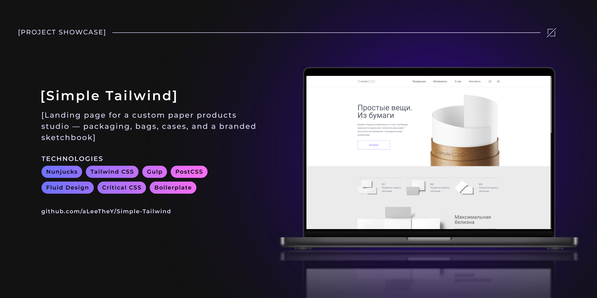
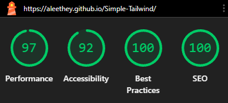
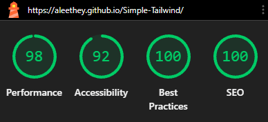

<!-- Improved compatibility of back to top link: See: https://github.com/othneildrew/Best-README-Template/pull/73 -->

<span id="readme-top"></span>

<!-- ! --- REPO SHIELDS --->
<!-- ! ---------------- --->

<div align="center">

[![Contributors][contributors-shield]][contributors-url] [![Forks][forks-shield]][forks-url] [![Stargazers][stars-shield]][stars-url] [![Issues][issues-shield]][issues-url] [![License][license-shield]][license-url]

![GitHub Last Commit][last-commit-shield] ![GitHub Repo Size][repo-size-shield]

[](README.md) [](README.ru.md)

</div>

<!-- ! --- REPO HEADER --->
<!-- ! --------------- --->

<br />
<div align="center">
  <h1 align="center">Simple Tailwind</h1>

  <p align="center">
    📄 Лендинг для студии бумажных изделий на заказ — упаковка, пакеты, кейсы и фирменный скетчбук.
    <br />
    <br />
    
    <hr />
    <b><a href="https://aleethey.github.io/Simple-Tailwind/">Демо</a></b>
    &middot;
    <b><a href="https://github.com/aLeeTheY/Simple-Tailwind/issues/new?labels=bug&template=bug-report.md">Сообщить об ошибке</a></b>
    <hr />
  </p>
</div>

<!-- ! --- TABLE OF CONTENTS --->
<!-- ! --------------------- --->

<details>
  <summary>📦 Содержание</summary>
  <ol>
    <li>
      <a href="#about-the-project">ℹ️ О проекте</a>
      <ul>
        <li><a href="#design">🎨 Дизайн</a></li>
        <li>
          <a href="#showcase">🎬 Демонстрация работы</a>
          <ul>
            <li><a href="#website-walkthrough">🖥️📱 Обзор лендинга</a></li>
            <li><a href="#fluid-design-demo">💧 Демонстрация fluid-адаптива</a></li>
          </ul>
        </li>
        <li><a href="#key-features">✨ Ключевые особенности</a></li>
        <li><a href="#built-with">🧰 Используемые технологии</a></li>
        <li><a href="#project-structure">📂 Структура проекта</a></li>
        <li><a href="#supported-browsers">🌐 Поддерживаемые браузеры</a></li>
      </ul>
    </li>
    <li>
      <a href="#quick-start">🚀 Начало работы</a>
      <ul>
        <li><a href="#prerequisites">📋 Предварительные требования</a></li>
        <li><a href="#installation">📥 Установка зависимостей</a></li>
        <li><a href="#build-launch">⚙️ Сборка и запуск</a></li>
      </ul>
    </li>
    <li><a href="#usage">💡 Использование</a></li>
    <li><a href="#development-challenges">🧠 Сложности при разработке</a></li>
    <li><a href="#key-skills">📈 Полученные навыки</a></li>
    <li><a href="#roadmap">🗺️ Дорожная карта</a></li>
    <li><a href="#license">📄 Лицензия</a></li>
    <li><a href="#contact">🤝 Контакты</a></li>
    <li><a href="#acknowledgments">💖 Благодарности</a></li>
  </ol>
</details>

<!-- ! --- ABOUT THE PROJECT --->
<!-- ! --------------------- --->

## ℹ️ О проекте <span id="about-the-project"></span>

Цель проекта — разработка одностраничного адаптивного лендинга для студии с акцентом на освоение [Tailwind CSS](https://tailwindcss.com/) и [Beasties](https://github.com/danielroe/beasties).

> [!NOTE]
> Фронтенд построен на базе авторской Gulp-сборки. Её документация доступна в репозитории:
>
> [**Wishbone-plus-Partners**](https://github.com/aLeeTheY/Wishbone-plus-Partners)

<p align="right">(<a href="#readme-top">наверх</a>)</p>

<!-- ! --- DESIGN --->
<!-- ! ---------- --->

### 🎨 Дизайн <a id="design"></a>

Визуальная часть базируется на макете [**Simple**](https://verstaem.online/layouts/simple) от платформы [**верстаем.онлайн**](https://verstaem.online/).<br />
Задача — воссоздать интерфейс с применением **Tailwind CSS** и адаптировать его под разные экраны.

<p align="right">(<a href="#readme-top">наверх</a>)</p>

<!-- ! --- DEMO / SHOWCASE --->
<!-- ! ------------------- --->

### 🎬 Демонстрация работы <span id="showcase"></span>

Видеодемонстрация проекта представлена ниже (_нажмите на любое изображение для перехода к live-демо_):

<div align="center">

#### 🖥️📱 Обзор лендинга (Desktop + Mobile) <span id="website-walkthrough"></span>

[![Обзор лендинга][01-website-walkthrough]](https://aleethey.github.io/Simple-Tailwind/)

<p align="right">(<a href="#readme-top">наверх</a>)</p>

#### 💧 Демонстрация fluid-адаптива (DevTools Stretch Test) <span id="fluid-design-demo"></span>

[![Демонстрация fluid-адаптива][02-fluid-design-demo]](https://aleethey.github.io/Simple-Tailwind/)

<p align="right">(<a href="#readme-top">наверх</a>)</p>

</div>

<!-- ! --- KEY FEATURES --->
<!-- ! ---------------- --->

### ✨ Ключевые особенности <span id="key-features"></span>

- 🧩 **Tailwind CSS:** современный подход к стилизации сайтов, с помощью утилитарных классов.
- ⚡ **Высокая скорость загрузки:** критический CSS инлайнится в <code encoded-by-transform-md="true">&lt;head&gt;</code>, растровые изображения конвертируются в AVIF/WebP, иконки собираются в SVG-спрайт, HTML/CSS минифицируются на этапе сборки.
- 💧 **Fluid Design:** резиновая вёрстка с плавной типографикой на основе 4-х breakpoint'ов (реализация через <code encoded-by-transform-md="true">clamp()</code>): mobile → tablet → laptop → desktop.

#### ⚡ Google Lighthouse Benchmark <a id="google-lighthouse-benchmark"></a>

В качестве подтверждения качества вёрстки ниже представлены результаты тестирования в бенчмарке **Google Lighthouse** (десктопная и мобильная версии):

<div align="center">

|                          🖥️ Desktop Version                          |                         📱 Mobile Version                          |
| :------------------------------------------------------------------: | :----------------------------------------------------------------: |
|  |  |

</div>

<p align="right">(<a href="#readme-top">наверх</a>)</p>

<!-- ! --- BUILT WITH --->
<!-- ! -------------- --->

### 🧰 Используемые технологии <span id="built-with"></span>

_Для удобства вся информация разбита по категориям._

<!-- <details>
<summary>🧩 Архитектура и паттерны</summary>

- [![MVVM][MVVM-logo]][MVVM-url] <sup>— архитектурный шаблон для разделения интерфейса и логики (Model-View-ViewModel)</sup>
- [![MVVM Command Pattern][MVVMCommandPattern-logo]][MVVMCommandPattern-url] <sup>— поведенческий паттерн для инкапсуляции действий приложения в команды</sup>

</details> -->

<details>
<summary>🎨 Фронтенд</summary>

- [![Nunjucks][Nunjucks-logo]][Nunjucks-url] <sup>— компонентный шаблонизатор для модульной сборки HTML-страниц</sup>
- [![Tailwind CSS][TailwindCSS-logo]][TailwindCSS-url] <sup>— утилитарный CSS-фреймворк для стилизации интерфейса</sup>

<!-- - [![TypeScript][TypeScript-logo]][TypeScript-url] <sup>— строготипизированный язык для разработки клиентской логики</sup> -->

</details>

<!-- <details>
<summary>⚙️ Backend (бизнес-логика)</summary>

- [![C#][C#-logo]][C#-url] <sup>— основной язык разработки приложения</sup>
- [![.NET Framework 4.8][DNF48-logo]][DNF48-url] <sup>— платформа выполнения приложения</sup>
- [![Entity Framework][EntityFramework-logo]][EntityFramework-url] <sup>— ORM для работы с базой данных через объекты C#</sup>
- [![NLog][NLog-logo]][NLog-url] <sup>— библиотека для логирования событий приложения</sup>

</details>

<details>
<summary>💾 База данных</summary>

- [![SQLite][SQLite-logo]][SQLite-url] <sup>— легковесная встраиваемая реляционная база данных</sup>

</details> -->

<details>
<summary>📦 Сборка</summary>

- [![Node.js][NodeJS-logo]][NodeJS-url] <sup>— runtime-окружение для JavaScript-пакетов</sup>
  - [![Npm][Npm-logo]][Npm-url] <sup>— менеджер JavaScript-пакетов и управление зависимостями</sup>
- [![Gulp 5][Gulp-logo]][Gulp-url] <sup>— таск-раннер и оркестратор пайплайнов сборки</sup>
  - **Пакеты, интегрированные в Gulp:**
    - [![SVGO][SVGO-logo]][SVGO-url] <sup>— обработка векторных изображений и создание SVG-спрайтов</sup>
    - [![Sharp][sharp-logo]][sharp-url] <sup>— обработка растровых изображений и генерация AVIF и WebP форматов в процессе сборки</sup>
    - [![PostCSS][PostCSS-logo]][PostCSS-url] <sup>— постобработка и оптимизация CSS-стилей</sup>
    - [![PostHTML][PostHTML-logo]][PostHTML-url] <sup>— постобработка и оптимизация HTML-файлов</sup>
  - **Внешние CLI-инструменты (автоматический вызов через Gulp):**
    - [![FFmpeg][ffmpeg-logo]][ffmpeg-url] <sup>— обработка аудио- и видеоассетов, генерация WebM формата в процессе сборки</sup>
    - [![Foundry Tools CLI][FoundryToolsCLI-logo]][FoundryToolsCLI-url] <sup>— конвертация исходных шрифтов OTF/TTF в форматы WOFF и WOFF2</sup>

</details>

<details>
<summary>🧪 Тестирование</summary>

- [![PlayWright][PlayWright-logo]][PlayWright-url] <sup>— ручное тестирование верстки в браузерных движках: Chromium (Google Chrome), Gecko (Mozilla Firefox) и WebKit (Safari)</sup>

</details>

<details>
<summary>📝 Стиль кода и форматирование</summary>

- [![Husky][Husky-logo]][Husky-url] <sup>— управление автоматическими Git-хуками на стороне клиента</sup>
  - [![lint-staged][LintStaged-logo]][LintStaged-url] <sup>— запуск линтинга и форматирования файлов перед коммитом (<code encoded-by-transform-md="true">pre&#8209;commit</code>)</sup>
  - [![Commitlint][CommitLint-logo]][CommitLint-url] <sup>— валидация Git-сообщений по спецификации Conventional Commits (с кастомными типами <code encoded-by-transform-md="true">wip</code> и <code encoded-by-transform-md="true">deploy</code>)</sup>
- [![Browserslist][Browserslist-logo]][Browserslist-url] <sup>— объявление списка целевых браузеров и их минимальных версий</sup>
- [![EditorConfig][EditorConfig-logo]][EditorConfig-url] <sup>— стиль кода, применяемый к редактору IDE по умолчанию</sup>
- [![ESLint][ESLint-logo]][ESLint-url] <sup>— линтер для TypeScript и JavaScript исходников (в т.ч. для конфигурационных файлов)</sup>
- [![Stylelint][Stylelint-logo]][Stylelint-url] <sup>— линтер для SCSS и CSS исходников</sup>
- [![Prettier][Prettier-logo]][Prettier-url] <sup>— автоматическое форматирование кода</sup>

</details>

<details>
<summary>🌿 Контроль версий и хостинг репозитория</summary>

- [![Git][Git-logo]][Git-url] <sup>— распределённая система контроля версий</sup>
- [![GitHub][GitHub-logo]][GitHub-url] <sup>— платформа для хранения исходного кода и публикации релизов</sup>
- [![GitHub Pages][GithubPages-logo]][GithubPages-url] <sup>— статический хостинг для демонстрационной версии сайта</sup>

</details>

<details>
<summary>🖥️ Инструменты разработки</summary>

- [![Figma][Figma-logo]][Figma-url] <sup>— инструмент проектирования UI/UX-макетов</sup>
- [![Visual Studio Code][VSCode-logo]][VSCode-url] <sup>— редактор кода</sup>

</details>

<p align="right">(<a href="#readme-top">наверх</a>)</p>

<!-- ! --- PROJECT STRUCTURE --->
<!-- ! --------------------- --->

### 📂 Структура проекта <span id="project-structure"></span>

Основные каталоги и файлы проекта:

```text
Simple-Tailwind/
│
├── .husky/                                         # Git-хуки
├── .vscode/
│
├── docs/                                           # Документация к проекту
│   ├── assets/
│   └── utils/
│
├── gulp/                                           # Исходный код авторской Gulp-сборки
│   ├── config/                                     # Конфигурационные файлы
│   │   ├── build.js
│   │   ├── env.js
│   │   ├── ftp.js
│   │   └── path.js
│   │
│   ├── helpers/                                    # Кастомные утилиты, используемые в разных тасках
│   │   ├── asset-exists.js
│   │   ├── django-domain.js
│   │   ├── error-handler.js
│   │   ├── html-img2picture-transformer.js
│   │   ├── inline-assets.js
│   │   └── path-resolver.js
│   │
│   └── tasks/                                      # Модули Gulp-тасков
│       ├── assets/                                 # Обработка статики
│       │   ├── fonts/
│       │   │   └── fonts.js
│       │   │
│       │   ├── media/
│       │   │   ├── audio.js
│       │   │   └── videos.js
│       │   │
│       │   ├── pictures/
│       │   │   ├── icons.js
│       │   │   └── images.js
│       │   │
│       │   └── misc.js
│       │
│       ├── core/                                   # Dev-модули: пайплайн, dev-сервер и вотчеры
│       │   ├── dev/
│       │   │   ├── server.js
│       │   │   └── watch.js
│       │   │
│       │   ├── clean.js
│       │   └── main-tasks.js
│       │
│       ├── html/                                   # Обработка HTML/Nunjucks
│       │   ├── nunjucks/
│       │   │   └── clean-file-system-nunjucks-loader.js
│       │   │
│       │   ├── djangoize-html.js
│       │   └── html.js
│       │
│       ├── meta/                                   # Обработка мета-файлов
│       │   └── meta.js
│       │
│       ├── scripts/                                # Обработка JS/TS
│       │   ├── libs.js
│       │   └── scripts.js
│       │
│       ├── styles/                                 # Обработка CSS/SCSS
│       │   ├── critical-css.js
│       │   ├── obfuscate-selectors.js
│       │   └── styles.js
│       │
│       └── utils/                                  # Прочие утилиты
│           ├── ftp.js
│           ├── revision.js
│           └── zip.js
│
├── src/
│   ├── assets/                                     # Статические ресурсы
│   │   ├── audio/
│   │   │   └── .gitkeep
│   │   │
│   │   ├── fonts/
│   │   │   └── Roboto/
│   │   │       ├── OFL.txt
│   │   │       └── Roboto-VariableFont_wdth,wght.ttf
│   │   │
│   │   ├── icons/
│   │   │   ├── companies/
│   │   │   │   ├── canson.svg
│   │   │   │   ├── fabriano.svg
│   │   │   │   ├── hahnemuehle.svg
│   │   │   │   └── royal_talens.svg
│   │   │   │
│   │   │   ├── copyright/
│   │   │   │   └── copyright.svg
│   │   │   │
│   │   │   ├── form/
│   │   │   │   ├── search-form__close-btn.svg
│   │   │   │   └── search-form__search-btn.svg
│   │   │   │
│   │   │   ├── logo/
│   │   │   │   └── logo.svg
│   │   │   │
│   │   │   ├── menu/
│   │   │   │   ├── close.svg
│   │   │   │   ├── hamburger_menu.svg
│   │   │   │   └── login.svg
│   │   │   │
│   │   │   ├── other/
│   │   │   │   └── arrow.svg
│   │   │   │
│   │   │   └── social/
│   │   │       ├── facebook.svg
│   │   │       ├── instagram.svg
│   │   │       ├── twitter.svg
│   │   │       └── youtube.svg
│   │   │
│   │   ├── images/
│   │   │   ├── assortment/
│   │   │   │   ├── sec3_img1.png
│   │   │   │   ├── sec3_img2.png
│   │   │   │   ├── sec3_img3.png
│   │   │   │   └── sec3_img4.png
│   │   │   │
│   │   │   ├── papers/
│   │   │   │   ├── paper_big.png
│   │   │   │   ├── paper_v1.png
│   │   │   │   ├── paper_v2.png
│   │   │   │   └── paper_v3.png
│   │   │   │
│   │   │   ├── hero.png
│   │   │   └── sketchbook.png
│   │   │
│   │   ├── misc/
│   │   │   └── .gitkeep
│   │   │
│   │   └── videos/
│   │       └── .gitkeep
│   │
│   ├── css/                                        # Исходники стилей Tailwind CSS
│   │   ├── layers/
│   │   │   ├── base.css
│   │   │   ├── components.css
│   │   │   ├── theme.css
│   │   │   └── utilities.css
│   │   │
│   │   └── main.css
│   │
│   ├── html/                                       # Шаблоны Nunjucks
│   │   ├── base/
│   │   │   └── base.njk
│   │   │
│   │   ├── common/
│   │   │   ├── footer.njk
│   │   │   └── header.njk
│   │   │
│   │   ├── components/
│   │   │   └── cookie_consent.njk
│   │   │
│   │   ├── macros/
│   │   │   ├── macro__current_page__get_full_url.njk
│   │   │   ├── macro__hreflang_meta_tags.njk
│   │   │   ├── macro__i18n_button__2_langs.njk
│   │   │   └── macro__inline_script.njk
│   │   │
│   │   ├── service/
│   │   │   ├── head.njk
│   │   │   ├── scripts__postload.njk
│   │   │   └── scripts__preload.njk
│   │   │
│   │   └── index.njk
│   │
│   ├── i18n/                                       # Локализация (не используется в проекте)
│   │   ├── languages.json
│   │   └── ru_RU.json
│   │
│   ├── libs/                                       # Сторонние JS-библиотеки
│   │   └── .gitkeep
│   │
│   ├── meta/                                       # SEO и мета-файлы
│   │   ├── favicon/
│   │   │   ├── apple-touch-icon.png
│   │   │   ├── favicon-96x96.png
│   │   │   ├── favicon.ico
│   │   │   ├── favicon.svg
│   │   │   ├── site.webmanifest
│   │   │   ├── web-app-manifest-192x192.png
│   │   │   └── web-app-manifest-512x512.png
│   │   │
│   │   ├── humans.txt
│   │   ├── robots.txt
│   │   └── sitemap.xml
│   │
│   ├── ts/                                         # Исходники скриптов TypeScript (не используются в проекте)
│   │   ├── modules/
│   │   │   └── postload/
│   │   │       └── .gitkeep
│   │   │
│   │   └── postload.ts
│   │
│   └── site.config.json                            # Базовые домены и префиксы путей URL для разных сценариев сборки
│
├── tests/                                          # Ручное тестирование вёрстки через PlayWright
│   └── playwright/
│       ├── example.spec.ts
│       └── start_manual_website_test_in_playwright_browsers.ts
│
├── .browserslistrc                                 # Список поддерживаемых браузеров
├── .editorconfig
├── .editorconfig-checker.json
├── .gitattributes
├── .gitignore
├── .lintstagedrc.yml
├── .npmrc
├── .prettierignore
├── .stylelintignore
├── commitlint.config.ts
├── eslint.config.ts                                # Конфигурация ESLint
├── gulpfile.js                                     # Главный файл Gulp-сборки
├── LICENSE
├── package-lock.json
├── package.json
├── playwright.config.ts
├── postcss.config.js                               # Конфигурация PostCSS
├── posthtml.config.js                              # Конфигурация PostHTML
├── prettier.config.mts
├── README.md
├── README.ru.md
├── stylelint.config.ts                             # Конфигурация Stylelint
├── svgo.config.mjs                                 # Конфигурация SVGO
└── tsconfig.json
```

<p align="right">(<a href="#readme-top">наверх</a>)</p>

<!-- ! --- SUPPORTED BROWSERS --->
<!-- ! ---------------------- --->

### 🌐 Поддерживаемые браузеры <a id="supported-browsers"></a>

Сайт проверен на корректность отображения в следующих браузерах:

- [![Google Chrome][GoogleChrome-logo]][GoogleChrome-url]
- [![Microsoft Edge][MicrosoftEdge-logo]][MicrosoftEdge-url]
- [![Yandex][Yandex-logo]][Yandex-url]
- [![Firefox][Firefox-logo]][Firefox-url]
- [![Opera][Opera-logo]][Opera-url]

> [!IMPORTANT]
> Проверено в последних стабильных версиях указанных выше браузеров на момент релиза **[1.0.0](https://github.com/aLeeTheY/Simple-Tailwind/releases/tag/1.0.0)**.
>
> **Дата последней проверки: 8 ноября 2026**

<p align="right">(<a href="#readme-top">наверх</a>)</p>

<!-- ! --- QUICK START --->
<!-- ! --------------- --->

## 🚀 Начало работы <span id="quick-start"></span>

_Следуйте приведённым ниже инструкциям для сборки и запуска проекта на локальном сервере._

### 📋 Предварительные требования <a id="prerequisites"></a>

1. Установите [Node.js][NodeJS-url], [FFmpeg][FFmpeg-url], [Python][Python-url] и [FoundryTools-CLI][FoundryToolsCLI-url].

2. Скачайте данный репозиторий в виде ZIP-архива или клонируйте его с помощью [Git][Git-url] и перейдите в каталог проекта:

```powershell
git clone https://github.com/aLeeTheY/Simple-Tailwind
cd Simple-Tailwind/
```

### 📥 Установка зависимостей <a id="installation"></a>

Находясь в каталоге проекта установите все необходимые зависимости:

```sh
npm install
```

### ⚙️ Сборка и запуск <a id="build-launch"></a>

Вы можете собрать проект, выполнив одну из следующих команд:

```sh
# сборка в development окружении с запуском локального сервера
npm run dev

# сборка в production окружении с запуском локального сервера
npm run prod

# сборка в production окружении для вашего домена (без запуска локального сервера)
npm run build

# сборка в production окружении для GitHub Pages (без запуска локального сервера)
npm run gh-pages
```

<p align="right">(<a href="#readme-top">наверх</a>)</p>

<!-- ! --- USAGE --->
<!-- ! --------- --->

## 💡 Использование <span id="usage"></span>

После завершения этапа "[**Начало работы**](#quick-start)" сайт будет доступен по URL <code encoded-by-transform-md="true">http://localhost:3000/</code>, а готовые файлы будут располагаться в директории <code encoded-by-transform-md="true">dist/</code>.

> [!NOTE]
> Проект можно использовать как шаблон (boilerplate) для ваших собственных лендингов.
> Для понимания устройства Gulp-пайплайна, его флагов и сценариев сборки рекомендуется изучить документацию проекта:
>
> [**Wishbone-plus-Partners**](https://github.com/aLeeTheY/Wishbone-plus-Partners)

<p align="right">(<a href="#readme-top">наверх</a>)</p>

<!-- ! --- DEVELOPMENT CHALLENGES --->
<!-- ! -------------------------- --->

## 🧠 Сложности при разработке <span id="development-challenges"></span>

- **Интеграция библиотеки Beasties:** [penthouse](https://github.com/pocketjoso/penthouse) и [puppeteer](https://github.com/puppeteer/puppeteer) не умеют работать с синтаксисом Tailwind CSS, в частности с конструкциями @layer, поэтому было принято решение переписать весь таск <code encoded-by-transform-md="true">critical&#8209;css.js</code> на генератор от библиотеки [Beasties](https://github.com/danielroe/beasties).

<p align="right">(<a href="#readme-top">наверх</a>)</p>

<!-- ! --- KEY SKILLS --->
<!-- ! -------------- --->

## 📈 Полученные навыки <span id="key-skills"></span>

- **Tailwind CSS:** освоен утилитарный подход к стилизации интерфейсов. Освоена директива <code encoded-by-transform-md="true">@layer</code>, а также базовые слои (layers) в Tailwind CSS.
- **Beasties Critical CSS:** освоена библиотека [Beasties](https://github.com/danielroe/beasties) и настроена её конфигурация для генерации критических стилей на замену устаревшему [penthouse](https://github.com/pocketjoso/penthouse).

<p align="right">(<a href="#readme-top">наверх</a>)</p>

<!-- ! --- ROADMAP --->
<!-- ! ----------- --->

## 🗺️ Дорожная карта <span id="roadmap"></span>

- [x] Разработка DOM на базе Nunjucks:
  - [x] Секция <code encoded-by-transform-md="true">&lt;header&gt;</code>
  - [x] Секция <code encoded-by-transform-md="true">&lt;footer&gt;</code>
  - [x] Секция <code encoded-by-transform-md="true">&lt;main&gt;</code>
  - [x] Секция <code encoded-by-transform-md="true">&lt;head&gt;</code>
- [x] Внедрение плагина **Tailwind CSS** в конфигурацию PostCSS.
- [x] Стилизация сайта и внедрение адаптивности (**Tablet** и **Desktop**) на базе **Tailwind CSS** в соответствии с дизайн-макетом и принципами **Fluid Design** на основе подхода **Mobile First**.
- [x] Внедрение генератора **Critical CSS** для Gulp-сборки на базе пакета **Beasties**.
- [x] Сборка проекта и его деплой на GitHub Pages.
- [x] Подготовка технической документации (<code encoded-by-transform-md="true">README.md</code>)

Полный список планируемых функций и известных проблем доступен в разделе [Issues][issues-url].

<p align="right">(<a href="#readme-top">наверх</a>)</p>

<!-- ! --- LICENSE --->
<!-- ! ----------- --->

## 📄 Лицензия <span id="license"></span>

Copyright © 2025–2026 [aLeeTheY](https://github.com/aLeeTheY)

Проект распространяется по лицензии [**MIT**](https://mit-license.org/).<br />Смотрите файл [<code encoded-by-transform-md="true">LICENSE</code>][license-url] для получения подробной информации.

<p align="right">(<a href="#readme-top">наверх</a>)</p>

<!-- ! --- CONTACT --->
<!-- ! ----------- --->

## 🤝 Контакты <span id="contact"></span>

<!-- [![GitHub][GitHub-logo]](https://github.com/aLeeTheY)
[![Telegram][Telegram-logo]](https://t.me/aLeeTheY)
[![Gmail][Gmail-logo]](mailto:aleethey@gmail.com) -->

GitHub: [aLeeTheY](https://github.com/aLeeTheY) <br/> Telegram: [@aLeeTheY](https://t.me/aLeeTheY) <br/> Email: [aleethey@gmail.com](mailto:aleethey@gmail.com)

<p align="right">(<a href="#readme-top">наверх</a>)</p>

<!-- ! --- ACKNOWLEDGMENTS --->
<!-- ! ------------------- --->

## 💖 Благодарности <span id="acknowledgments"></span>

[aLeeTheY](https://github.com/aLeeTheY) выражает благодарность разработчикам и сообществам следующих проектов:

- [верстаем.онлайн](https://verstaem.online/) (за дизайн-макет **Simple**)
- [Figma](https://www.figma.com/)
- [Visual Studio Code](https://code.visualstudio.com/)
- [Nunjucks](https://mozilla.github.io/nunjucks/)
- [Tailwind CSS](https://tailwindcss.com/)
- [Node.js](https://nodejs.org/)
- [Npm](https://www.npmjs.com/)
- [Gulp](https://gulpjs.com/)
- [Sharp](https://sharp.pixelplumbing.com/)
- [SVGO](https://github.com/svg/svgo)
- [PostHTML](https://github.com/posthtml/posthtml)
- [PostCSS](https://postcss.org/)
- [Beasties](https://github.com/danielroe/beasties)
- [EditorConfig](https://editorconfig.org/)
- [Browserslist](https://github.com/browserslist/browserslist)
- [ESLint](https://eslint.org/)
- [Stylelint](https://stylelint.io/)
- [Prettier](https://prettier.io/)
- [Husky](https://typicode.github.io/husky/)
- [lint-staged](https://github.com/lint-staged/lint-staged)
- [Commitlint](https://commitlint.js.org/)
- [Playwright](https://playwright.dev/)
- [Git](https://git-scm.com/)
- [GitHub](https://github.com/)
- [Shields.io](https://shields.io/) (за красивые бейджи)
- [Custom Icon Badges](https://github.com/DenverCoder1/custom-icon-badges)
- [Chocolatey](https://chocolatey.org/)
- [FFmpeg](https://www.ffmpeg.org/)
- [gifsicle](https://github.com/kohler/gifsicle)
- [ezgif.com](https://ezgif.com/)
- [Chrome DevTools](https://developer.chrome.com/docs/devtools)
- [Lighthouse](https://developer.chrome.com/docs/lighthouse/overview)

Без этих инструментов разработка данного проекта была бы **невозможна**.

<p align="right">(<a href="#readme-top">наверх</a>)</p>

<!-- ! --- MARKDOWN LINKS --->
<!-- ! ------------------ --->

<!-- * shields --->

[contributors-shield]: https://img.shields.io/github/contributors/aLeeTheY/Simple-Tailwind.svg?style=for-the-badge
[contributors-url]: https://github.com/aLeeTheY/Simple-Tailwind/graphs/contributors
[forks-shield]: https://img.shields.io/github/forks/aLeeTheY/Simple-Tailwind.svg?style=for-the-badge
[forks-url]: https://github.com/aLeeTheY/Simple-Tailwind/network/members
[stars-shield]: https://img.shields.io/github/stars/aLeeTheY/Simple-Tailwind.svg?style=for-the-badge
[stars-url]: https://github.com/aLeeTheY/Simple-Tailwind/stargazers
[issues-shield]: https://img.shields.io/github/issues/aLeeTheY/Simple-Tailwind.svg?style=for-the-badge
[issues-url]: https://github.com/aLeeTheY/Simple-Tailwind/issues
[last-commit-shield]: https://img.shields.io/github/last-commit/aLeeTheY/Simple-Tailwind?style=for-the-badge
[repo-size-shield]: https://img.shields.io/github/repo-size/aLeeTheY/Simple-Tailwind?style=for-the-badge
[license-shield]: https://img.shields.io/github/license/aLeeTheY/Simple-Tailwind.svg?style=for-the-badge
[license-url]: https://github.com/aLeeTheY/Simple-Tailwind/blob/master/LICENSE

<!-- * technologies | main --->

[Nunjucks-logo]: https://custom-icon-badges.demolab.com/badge/Nunjucks-3d8137?logo=nunjucks&style=for-the-badge
[Nunjucks-url]: https://mozilla.github.io/nunjucks/
[TailwindCSS-logo]: https://img.shields.io/badge/tailwindcss-38B2AC.svg?style=for-the-badge&logo=tailwind-css&logoColor=white
[TailwindCSS-url]: https://tailwindcss.com/

<!-- [TypeScript-logo]: https://img.shields.io/badge/TypeScript-3178C6?logo=typescript&logoColor=fff&style=for-the-badge
[TypeScript-url]: https://www.typescriptlang.org/ -->

<!-- * technologies | build --->

[NodeJS-logo]: https://img.shields.io/badge/Node.js-6DA55F?logo=node.js&logoColor=white&style=for-the-badge
[NodeJS-url]: https://nodejs.org/
[Npm-logo]: https://img.shields.io/badge/npm-CB3837?logo=npm&logoColor=fff&style=for-the-badge
[Npm-url]: https://www.npmjs.com/
[Gulp-logo]: https://img.shields.io/badge/GULP-%23CF4647.svg?style=for-the-badge&logo=gulp&logoColor=white
[Gulp-url]: https://gulpjs.com/
[PostCSS-logo]: https://img.shields.io/badge/PostCSS-%23DD3A0A.svg?style=for-the-badge&logo=postcss&logoColor=white
[PostCSS-url]: https://postcss.org/
[PostHTML-logo]: https://custom-icon-badges.demolab.com/badge/PostHTML-ffffff?logo=posthtml&style=for-the-badge
[PostHTML-url]: https://github.com/posthtml/posthtml
[SVGO-logo]: https://custom-icon-badges.demolab.com/badge/SVGO-12222b?logo=svgo&style=for-the-badge
[SVGO-url]: https://svgo.dev/
[Browserslist-logo]: https://custom-icon-badges.demolab.com/badge/browserslist-1d1d1d?logo=browserslist&style=for-the-badge
[Browserslist-url]: https://github.com/browserslist/browserslist
[Sharp-logo]: https://custom-icon-badges.demolab.com/badge/Sharp-1f2a1c?logo=sharp&style=for-the-badge
[Sharp-url]: https://sharp.pixelplumbing.com/

<!-- * technologies | url only --->

[Python-url]: https://www.python.org/

<!-- * architecture & patterns --->

<!-- [MVVM-logo]: https://custom-icon-badges.demolab.com/badge/MVVM-1f1f1f?&style=for-the-badge&logoColor=white
[MVVM-url]: https://learn.microsoft.com/en-us/dotnet/architecture/maui/mvvm
[MVVMCommandPattern-logo]: https://custom-icon-badges.demolab.com/badge/MVVM%20Command%20Pattern-1f1f1f?&style=for-the-badge&logoColor=white
[MVVMCommandPattern-url]: https://learn.microsoft.com/en-us/archive/msdn-magazine/2013/may/mvvm-commands-relaycommands-and-eventtocommand -->

<!-- * linters & code format --->

[EditorConfig-logo]: https://custom-icon-badges.demolab.com/badge/EditorConfig-010101?logo=editorconfig&style=for-the-badge
[EditorConfig-url]: https://editorconfig.org/
[ESLint-logo]: https://img.shields.io/badge/ESLint-4B3263?style=for-the-badge&logo=eslint&logoColor=white
[ESLint-url]: https://eslint.org/
[Stylelint-logo]: https://custom-icon-badges.demolab.com/badge/Stylelint-1b1b1d?logo=stylelint&style=for-the-badge
[Stylelint-url]: https://stylelint.io/
[Prettier-logo]: https://img.shields.io/badge/prettier-F7B93E.svg?style=for-the-badge&logo=prettier&logoColor=black
[Prettier-url]: https://prettier.io/
[Commitlint-logo]: https://custom-icon-badges.demolab.com/badge/Commitlint-1b1b1f?logo=commitlint&style=for-the-badge
[Commitlint-url]: https://commitlint.js.org/
[LintStaged-logo]: https://custom-icon-badges.demolab.com/badge/Lint--Staged-ffffff?logo=lintstaged&style=for-the-badge
[LintStaged-url]: https://github.com/lint-staged/lint-staged
[Husky-logo]: https://custom-icon-badges.demolab.com/badge/Husky-607d8b?logo=husky-vscode&style=for-the-badge
[Husky-url]: https://typicode.github.io/husky/

<!-- [esbuild-logo]: https://img.shields.io/badge/esbuild-%23FFCF00.svg?style=for-the-badge&logo=esbuild&logoColor=black
[esbuild-url]: https://esbuild.github.io/ -->

[Playwright-logo]: https://custom-icon-badges.demolab.com/badge/Playwright-242526?logo=playwright&style=for-the-badge
[Playwright-url]: https://playwright.dev/

<!-- * cli tools --->

[ffmpeg-logo]: https://shields.io/badge/FFmpeg-%23171717.svg?logo=ffmpeg&style=for-the-badge&labelColor=171717&logoColor=5cb85c
[ffmpeg-url]: https://ffmpeg.org/
[FoundryToolsCLI-logo]: https://custom-icon-badges.demolab.com/badge/Foundry%20Tools%20CLI-000000?logo=foundry-tools-cli&style=for-the-badge
[FoundryToolsCLI-url]: https://github.com/ftCLI/FoundryTools-CLI

<!-- * ide & workspace --->

[VSCode-logo]: https://custom-icon-badges.demolab.com/badge/Visual%20Studio%20Code-0d1014?logo=vscode&logoColor=white&style=for-the-badge
[VSCode-url]: https://code.visualstudio.com/
[Figma-logo]: https://img.shields.io/badge/figma-%23F24E1E.svg?style=for-the-badge&logo=figma&logoColor=white
[Figma-url]: https://www.figma.com/

<!-- * version control --->

[Git-logo]: https://img.shields.io/badge/git-F05033?style=for-the-badge&logo=git&logoColor=white
[Git-url]: https://git-scm.com/
[GitHub-logo]: https://img.shields.io/badge/github-121011?style=for-the-badge&logo=github&logoColor=white
[GitHub-url]: https://github.com/
[GithubPages-logo]: https://img.shields.io/badge/github%20pages-121013?style=for-the-badge&logo=github&logoColor=white
[GithubPages-url]: https://pages.github.com/

<!-- * browsers --->

[Opera-logo]: https://img.shields.io/badge/Opera-FF1B2D?logo=Opera&logoColor=white&style=for-the-badge
[Opera-url]: https://www.opera.com/
[GoogleChrome-logo]: https://img.shields.io/badge/Google%20Chrome-4285F4?logo=GoogleChrome&logoColor=white&style=for-the-badge
[GoogleChrome-url]: https://www.google.com/chrome/
[MicrosoftEdge-logo]: https://custom-icon-badges.demolab.com/badge/Microsoft%20Edge-2771D8?logo=edge-white&logoColor=white&style=for-the-badge
[MicrosoftEdge-url]: https://www.microsoft.com/en-us/edge/
[Firefox-logo]: https://img.shields.io/badge/Firefox-FF7139?logo=firefoxbrowser&logoColor=white&style=for-the-badge
[Firefox-url]: https://www.firefox.com/
[Yandex-logo]: https://custom-icon-badges.demolab.com/badge/Yandex%20Browser-F03911?logo=yandex-browser&style=for-the-badge
[Yandex-url]: https://browser.yandex.com/

<!-- * contacts --->

<!-- [GitHub-logo]: https://img.shields.io/badge/github-%23121011.svg?style=for-the-badge&logo=github&logoColor=white
[Telegram-logo]: https://img.shields.io/badge/Telegram-2CA5E0?style=for-the-badge&logo=telegram&logoColor=white
[Gmail-logo]: https://img.shields.io/badge/Gmail-D14836?style=for-the-badge&logo=gmail&logoColor=white -->

<!-- ! --- MARKDOWN ASSETS --->
<!-- ! ------------------- --->

[01-website-walkthrough]: docs/assets/01__website_walkthrough.gif
[02-fluid-design-demo]: docs/assets/02__fluid_design_demo.gif
